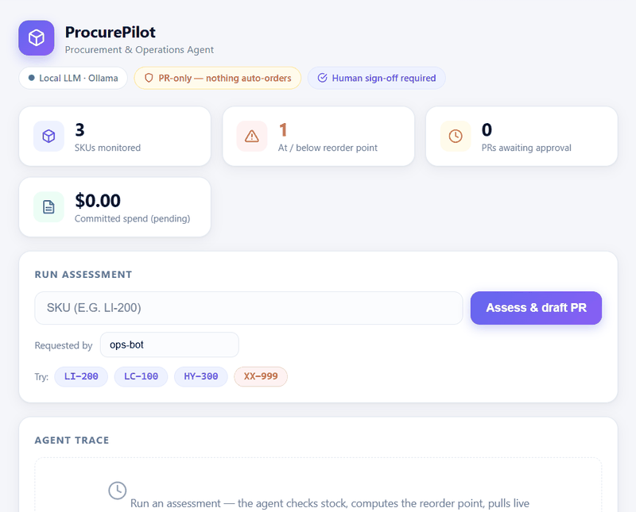
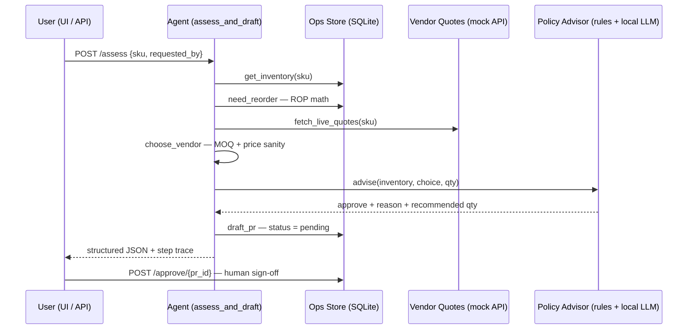
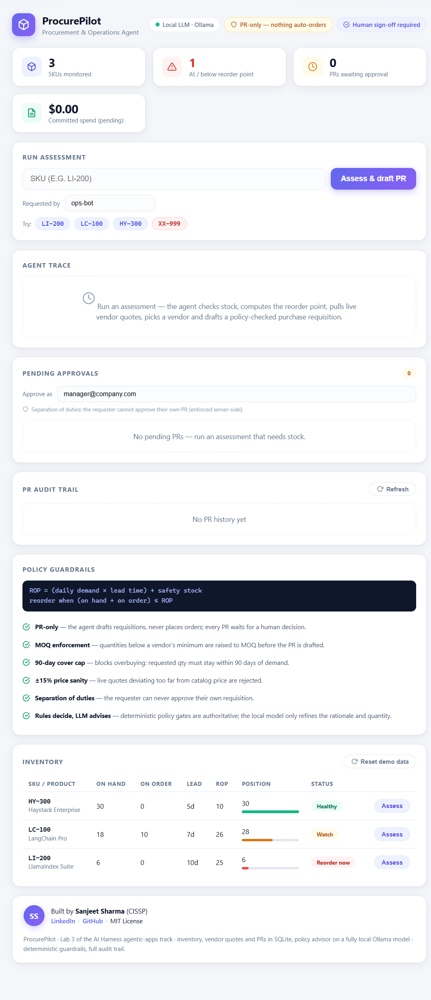
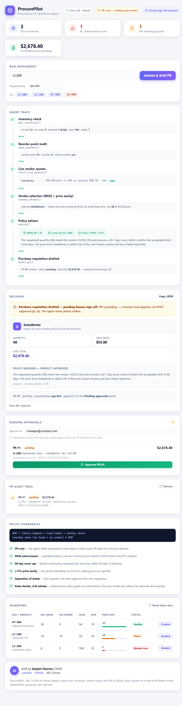
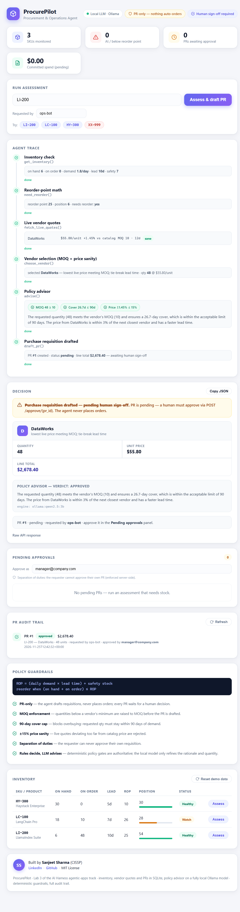

# ProcurePilot — Procurement & Operations Agent

> **Lab 3 of the AI Harness agentic-apps track.** An agent that answers *"Do we need to reorder SKU X?"* with real reorder-point math, pulls live vendor quotes, drafts a policy-checked purchase requisition (PR), and hands it to a human approval queue — never placing an order itself, with a full explainable step trace. In business terms: it keeps stock inside policy — no stockouts, no overbuying — while every purchase stays behind a human approval gate with a complete audit trail.

    



**Taxonomy:** Segment `Business Agents` → Category `Procurement & Operations` → Sub-category `Purchase Requisition Automation`

---

## What value it provides

| Value | How |
|---|---|
| **Fully local & private** | The policy advisor runs on a local Ollama model; inventory, vendors and PRs live in a local SQLite store. Zero data leaves the box, zero API cost. |
| **Guardrailed by rules, advised by LLM** | Deterministic policy gates (MOQ, 90-day cover cap, ±15% price sanity, separation of duties) are the authority — the LLM only refines the rationale and quantity. The agent stays safe with or without a model running. |
| **Human-in-the-loop by design** | The agent drafts PRs in `pending` status; a human signs off via the approval queue. There is no order-placement code path at all. |
| **Explainable by default** | Every assessment returns a step-by-step trace — inventory read, ROP math, per-vendor quotes, selection rationale, policy verdicts, PR draft. |
| **Clean JSON for apps & dashboards** | One `POST /assess` returns a structured decision payload (position, ROP, vendor, qty, price, policy verdict, PR) plus the trace — ready for any BI tool or chatbot. |
| **Stateful demo loop** | Approving a PR moves its quantity into `on_order`, so the inventory position visibly improves and the next assessment says "no reorder needed" — the loop closes in front of you. |

---

## How it works

The agent orchestrates five tools over an SQLite ops store (inventory, vendors, PRs). The reorder-point math is deterministic; the vendor choice respects MOQ and a price-sanity band; the local LLM is an *advisor*, not a gate:

```python
rop = round(daily_demand * lead_time_days + safety_stock)   # ROP formula
needs_reorder = (on_hand + on_order) <= rop                  # position vs ROP
```

### Tools

| Tool | Returns |
|---|---|
| `get_inventory` | Stock record: on hand, on order, lead time, daily demand, safety stock |
| `need_reorder` | Reorder point, inventory position, needs-reorder verdict |
| `fetch_live_quotes` | Per-vendor live price (catalog ± jitter), deviation %, MOQ, lead time, sanity flag |
| `choose_vendor` | Lowest sane live price meeting MOQ (tie-break: lead time); below-MOQ requests are raised to MOQ |
| `advise` | Policy verdict + human-readable reason + recommended qty (rules decide, `qwen2.5:3b` advises) |
| `draft_pr` | Purchase requisition in `pending` status with requester + timestamp for audit |

### Sequence



```mermaid
flowchart LR
    A[POST /assess] --> B{SKU found?}
    B -- no --> E[Explain and stop]
    B -- yes --> C[ROP math]
    C --> D{position ≤ ROP?}
    D -- no --> F[No reorder needed]
    D -- yes --> G[Live quotes → vendor selection]
    G --> H[Policy gates<br/>MOQ · cover · price sanity]
    H -- blocked --> I[Block with reason]
    H -- pass --> J[Draft pending PR]
    J --> K[Human approves<br/>POST /approve/{id}]
```

---

## Interface

### Web dashboard (`http://127.0.0.1:8082`)

- **KPI strip** — SKUs monitored, at/below reorder point, PRs awaiting approval, committed spend
- **Run assessment** — SKU + requester with one-click presets (incl. `XX-999` to demo the graceful not-found path)
- **Agent trace** — live timeline of every step with per-vendor quote rows and policy check chips
- **Decision card** — vendor, quantity (MOQ adjustments flagged), unit price, line total, advisor verdict, and the raw API JSON with copy button
- **Pending approvals** — approve-as-identity input, separation-of-duties note, one-click human sign-off
- **PR audit trail** — every PR with status, requester, approver and timestamp
- **Inventory table** — position vs reorder point with status pills and progress bars, plus *Reset demo data*







### REST API

| Method | Path | Purpose |
|---|---|---|
| `GET` | `/inventory` | All SKUs with ROP math and status buckets (`ok` / `watch` / `reorder`) |
| `GET` | `/inventory/{sku}` | One stock record |
| `POST` | `/assess` | Full flow: assess → quotes → vendor → policy → pending PR. Body: `{"sku": "LI-200", "requested_by": "alex"}` |
| `GET` | `/pr/open` | Pending purchase requisitions |
| `GET` | `/pr/recent` | Latest PRs (audit trail) |
| `POST` | `/approve/{pr_id}` | Human sign-off. Body: `{"approver": "ops_manager"}`. Requester ≠ approver enforced |
| `POST` | `/admin/reset` | Reseed demo data (inventory, vendors; clears PR history) |
| `GET` | `/` | The dashboard |

```bash
# Assess & draft a PR (auto-runs the full policy flow)
curl -X POST http://127.0.0.1:8082/assess \
     -H 'Content-Type: application/json' \
     -d '{"sku":"LI-200","requested_by":"alex"}'

# See open PRs, then approve one
curl -s http://127.0.0.1:8082/pr/open | jq
curl -X POST http://127.0.0.1:8082/approve/1 \
     -H 'Content-Type: application/json' -d '{"approver":"ops_manager"}'
```

The assess response is a single structured JSON: `needs_reorder`, `reorder_point`, `position`, `selected_vendor` (qty / unit price / MOQ adjustments), `policy` (verdict, checks, engine), `pr` (id, status, line total), `approval` (status + reason) and `steps[]` — the full trace.

---

## Usage

**Prerequisites:** Python 3.11+. Optional: [Ollama](https://ollama.com) running locally with a small model pulled — without it the advisor falls back to deterministic rules and everything still works:

```bash
ollama pull qwen2.5:3b
```

**Install & run** (Windows; on macOS/Linux use `.venv/bin/`):

```bash
cd "Business Agents/procurement-operations/procurement-ops-agent"
python -m venv .venv
.venv\Scripts\python -m pip install -r requirements.txt
.venv\Scripts\python -m uvicorn main:app --port 8082
```

Open **http://127.0.0.1:8082**, pick the `LI-200` preset (below its reorder point), and watch the agent draft a PR — then approve it and watch the inventory position recover.

**Configuration** (`.env`, gitignored):

| Var | Default | Role |
|---|---|---|
| `OLLAMA_BASE_URL` | `http://localhost:11434` | Ollama endpoint |
| `OLLAMA_MODEL` | `qwen2.5:3b` | Policy advisor (narrative + qty refinement) |

The database (`ops.db`) is created and seeded automatically on first start; existing data — including PR history — survives restarts. Use **Reset demo data** (or `POST /admin/reset`) for a clean slate.

---

## Security & guardrails

- **PR-only** — there is no order-placement code path; the system can only create requisitions in `pending` status and record human sign-offs.
- **Deterministic gates decide** — MOQ compliance, ≤90-day cover cap and ±15% price sanity are enforced in code; the LLM advisor refines the reason/quantity but can never bypass a rule.
- **Separation of duties** — `/approve` rejects when the approver equals the requester (case-insensitive), enforced server-side.
- **Auditable** — every PR stores `requested_by`, `approved_by`, `created_at`; the UI exposes the full audit trail; every assessment returns its tool trace.
- **Input sanitization** — SKU and identity fields are stripped to a safe charset and length-capped before they reach SQL or the LLM prompt.
- **Price sanity** — live quotes deviating more than ±15% from catalog price are flagged and excluded from selection.
- **No hardcoded secrets** — config lives in a gitignored `.env`; the ops store holds synthetic demo data only.
- **Known limits (by design, it's a lab)** — vendor quotes are a mock (catalog ± jitter); the API and reset endpoint have no auth; approval moves qty to `on_order` but there is no goods-receipt flow back to `on_hand`.

---

## From lab to production — the autonomy ladder

| Level | Milestone | What it takes |
|---|---|---|
| **L0 — this lab** | Manual trigger, mock vendor API, SQLite store, single-step human approval | ✅ done |
| **L1 — real integrations** | Real inventory/ERP data, live vendor price APIs, Postgres, multi-currency catalog | ERP/vendor API credentials, data contracts |
| **L2 — human-in-the-loop at scale** | Approval queue with roles + value-based thresholds (e.g. >$5k needs director), Slack/Teams approve buttons, immutable audit trail | Identity provider, approval-state machine, notification webhooks |
| **L3 — scheduled autonomy** | Nightly replenishment scan across all SKUs, demand forecasting (exponential smoothing/ARIMA), full EOQ, multi-vendor split optimization, budget caps | Job scheduler, forecast pipeline, budget service |
| **L4 — production procurement** | PO transmission via EDI/API, goods-receipt closure of the loop (`on_order` → `on_hand`), supplier scorecards, price-anomaly detection, compliance review | EDI integration, supplier portal, compliance sign-off, containers + CI/CD |

The tool set, policy gates, trace format and PR-state model built here carry forward unchanged — production work is swapping the mock quote API for real vendor integrations and wrapping the flow in the L1–L4 operational layers.

---

## Project layout

```
procurement-ops-agent/
├── ops_db.py          # SQLite engine, schema, seed-once + reset
├── ops.py             # inventory / ROP math / PR CRUD + separation of duties
├── vendors_api.py     # mock live quotes + vendor selection (MOQ, price sanity)
├── policy_llm.py      # deterministic policy gates + Ollama advisor w/ rules fallback
├── agent.py           # assess_and_draft orchestration returning a step trace
├── main.py            # FastAPI service (dashboard + clean JSON API)
├── static/index.html  # dashboard (self-contained, no build step)
├── requirements.txt   # fastapi · uvicorn · sqlalchemy · requests · python-dotenv
├── .env               # local config (gitignored)
└── docs/assets/       # screenshots
```

---

*Built as **Lab 3: Procurement & Operations Agent** in the AI Harness track — the classic inventory → reorder-point → vendor-quote → PR-approval workflow, with deterministic guardrails, a local Ollama advisor, and a human sign-off gate.*

*Authored by **Sanjeet Sharma** (CISSP) · [LinkedIn](https://www.linkedin.com/in/sanjeet-sharma-cissp-17b68570/) · [GitHub](https://github.com/SharmaSanjeet) · [MIT License](../../../LICENSE)*
