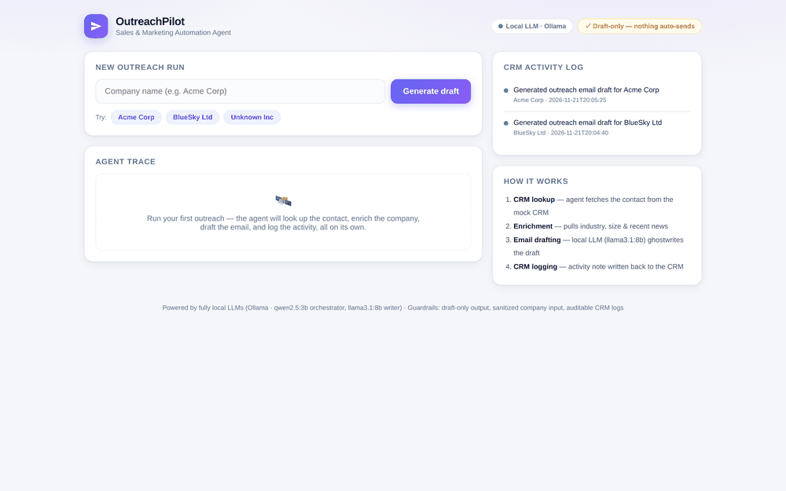
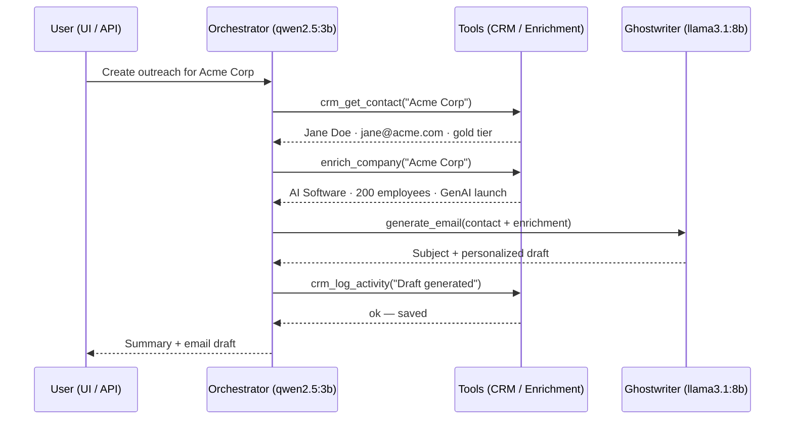
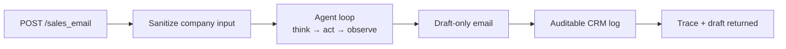
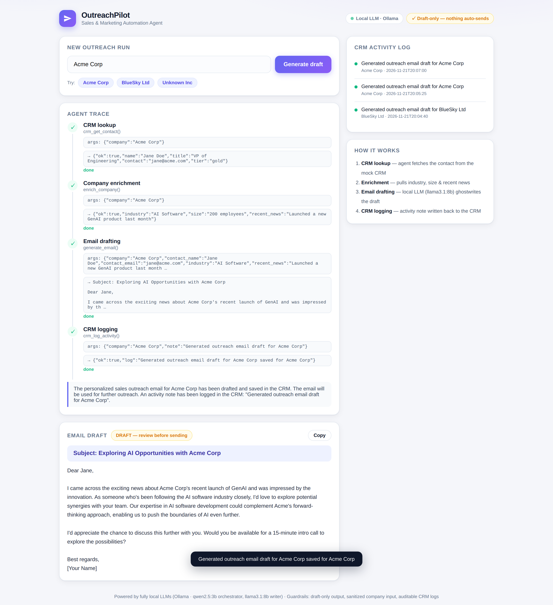
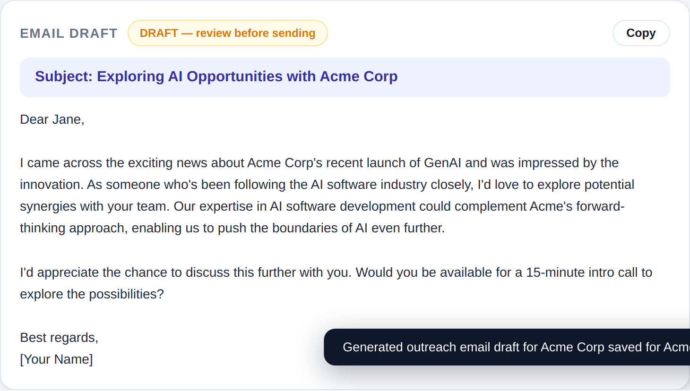

# Lead Outreach Agent — Sales & Marketing Automation

> **Lab 1 of the AI Harness agentic-apps track.** An autonomous agent that takes a company name, pulls the contact from a CRM, enriches it with firmographic data, ghostwrites a personalized outreach email with a local LLM, and logs the activity back to the CRM — with a full, explainable tool-call trace.

   



**Taxonomy:** Segment `Business Agents` → Category `Sales & Marketing` → Sub-category `Lead Outreach Automation`

---

## What value it provides

| Value | How |
|---|---|
| **Fully local & private** | Both LLMs run on your machine via Ollama — no lead data, contacts, or drafts ever leave the box. Zero API cost per run. |
| **Explainable by default** | Every run returns a step-by-step tool-call trace (args + results). You can audit exactly *why* the agent wrote what it wrote. |
| **Guardrailed** | Draft-only output (no send path exists in the code at all), input sanitization against prompt injection, timestamped CRM audit log. |
| **Real agent, not a pipeline** | The orchestrator *decides* which tool to call and in what order (think → act → observe) — swap the mock tools for real APIs and the loop is unchanged. |
| **Two interfaces** | A polished web dashboard for demos, plus a REST API (`POST /sales_email`) for integration into anything else. |
| **Extensible tool pattern** | Adding a channel (Slack, Gmail) or a data source is one `@tool` function — no orchestration changes. |

---

## How it works

Two local models split the work: a fast **orchestrator** (`qwen2.5:3b`, temp 0.1) decides which tool to call next; a **ghostwriter** (`llama3.1:8b`, temp 0.7) drafts the email prose. The agent loop is implemented explicitly (plain `langchain-core`, no LangGraph runtime) so the machinery stays readable:

```python
for _ in range(MAX_STEPS):                    # THINK
    ai = router_with_tools.invoke(messages)   # model picks a tool (or answers)
    if not ai.tool_calls:
        break
    for call in ai.tool_calls:                # ACT
        output = TOOLS_BY_NAME[call["name"]].invoke(call["args"])
        messages.append(ToolMessage(...))     # OBSERVE → loop continues
```

### Tools

| Tool | Returns |
|---|---|
| `crm_get_contact` | Contact name, title, email, customer tier |
| `enrich_company` | Industry, employee size, recent news |
| `generate_email` | Subject + ≤120-word personalized draft (ghostwriter LLM) |
| `crm_log_activity` | Timestamped CRM activity entry |

### Sequence





---

## Interface

### Web dashboard (`http://127.0.0.1:8080`)

- **New outreach run** — company input with one-click presets (incl. an *Unknown Inc* chip to demo the refusal path)
- **Agent trace** — live timeline of every tool call with args/results, then the agent's summary
- **Email draft** — subject + body with a *DRAFT — review before sending* badge and copy button
- **CRM activity log** — every logged activity with company + timestamp





### REST API

| Method | Path | Purpose |
|---|---|---|
| `POST` | `/sales_email` | Run the full outreach flow. Body: `{"company": "Acme Corp"}` |
| `GET` | `/activities` | Recent CRM activity entries (newest first) |
| `GET` | `/` | The dashboard |

```bash
curl -X POST http://127.0.0.1:8080/sales_email \
     -H 'Content-Type: application/json' \
     -d '{"company":"Acme Corp"}'
```

Response (trimmed): `steps[]` (tool, label, args, result), `email` (draft text), `log` (CRM confirmation), `summary` (agent's final message). Unknown companies return `"email": null` — the agent stops and explains instead of inventing data.

---

## Usage

**Prerequisites:** Python 3.11+, [Ollama](https://ollama.com) running locally with two models pulled:

```bash
ollama pull qwen2.5:3b
ollama pull llama3.1:8b
```

**Install & run** (Windows; on macOS/Linux use `.venv/bin/`):

```bash
cd "Business Agents/sales-marketing/lead-outreach-agent"
python -m venv .venv
.venv\Scripts\python -m pip install -r requirements.txt
.venv\Scripts\python -m uvicorn main:app --port 8080
```

Open **http://127.0.0.1:8080**, pick a preset, and watch the trace.

**Configuration** (`.env`, gitignored):

| Var | Default | Role |
|---|---|---|
| `OLLAMA_BASE_URL` | `http://localhost:11434` | Ollama endpoint |
| `OLLAMA_MODEL` | `qwen2.5:3b` | Orchestrator (tool calling) |
| `GHOSTWRITER_MODEL` | `llama3.1:8b` | Email prose writer |

**Performance reference** (RTX 5050 laptop GPU, 8 GB): ~24 s per full run — orchestrator at ~124 tok/s, writer at ~66 tok/s, both 100% GPU. Models stay resident (`keep_alive=30m`) and drafts are capped (`num_predict=300`).

---

## Security & guardrails

- **Draft-only** — there is no email-send code path; the system prompt also forbids the agent from claiming a send.
- **Injection prevention** — company input is stripped to a safe charset and length-capped before it reaches CRM lookups or any LLM prompt.
- **Auditable** — every run exposes its full tool trace; every CRM write is timestamped and returned to the caller.
- **No hardcoded secrets** — config lives in a gitignored `.env`; the mock CRM holds synthetic data only.
- **Known limits (by design, it's a lab)** — CRM/enrichment are in-memory mocks; the activity log resets on restart; no auth on the API.

---

## From lab to production — the autonomy ladder

| Level | Milestone | What it takes |
|---|---|---|
| **L0 — this lab** | Manual trigger, mock CRM/enrichment, in-memory audit log | ✅ done |
| **L1 — real integrations** | Real CRM (Salesforce/HubSpot/Pipedrive APIs) + real enrichment (Clearbit/Apollo); SQLite/Postgres for leads & logs; template styles (intro / follow-up / re-engagement); lead scoring to prioritize the queue | OAuth app credentials, API budgets, data model |
| **L2 — human-in-the-loop at scale** | Approval queue (approve / edit / reject per draft), API auth + RBAC, immutable audit trail of who approved what, A/B variants ranked by an LLM judge | Draft-state machine, identity provider, review UI |
| **L3 — scheduled autonomy** | Nightly job pulls new/changed leads and pre-drafts automatically; streaming trace (SSE); observability (Langfuse traces, latency/cost metrics); eval harness that scores draft quality and catches regressions; retries, timeouts, model fallbacks | Job scheduler, telemetry stack, golden-set evals |
| **L4 — production SDR** | Multi-channel delivery (Gmail API / SES, Slack) with send-time windows, compliance guardrails (opt-out checks, CAN-SPAM/GDPR), RAG grounding on the product knowledge base, CRM write-back of replies and threading context | Compliance review, deliverability infra, retrieval pipeline, deployment (containers, CI/CD, secrets manager) |

The agent loop, tool registry, trace format and guardrails built here carry forward unchanged — production work is swapping mocks for real tools and wrapping the loop in the L1–L4 operational layers.

---

## Project layout

```
lead-outreach-agent/
├── agent.py           # @tool definitions + the think→act→observe loop
├── crm.py             # mock CRM, enrichment data, activity log, input sanitizer
├── main.py            # FastAPI service (UI + REST API)
├── static/index.html  # dashboard (self-contained, no build step)
├── requirements.txt   # fastapi · uvicorn · langchain-ollama · python-dotenv
├── .env               # local config (gitignored)
└── docs/assets/       # screenshots + demo.gif
```

---

*Built as **Lab 1: Sales & Marketing Automation Agent** in the AI Harness track — the classic CRM → enrich → generate → log workflow, modernized onto a current LangChain stack with local Ollama models and a hand-rolled agent loop for full transparency.*

*Authored by **Sanjeet Sharma** (CISSP) · [LinkedIn](https://www.linkedin.com/in/sanjeet-sharma-cissp-17b68570/) · [GitHub](https://github.com/SharmaSanjeet) · [MIT License](../../../LICENSE)*
