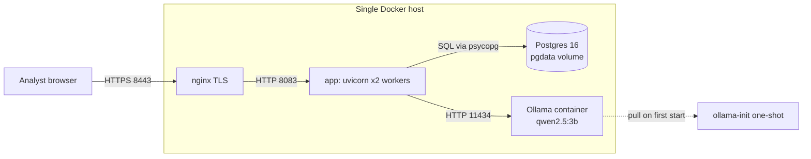

# LedgerLens — Production Deployment Guide

This guide takes LedgerLens from its lab form (SQLite, localhost Ollama, `uvicorn main.py`) to a
production-ready single-node deployment: Docker, PostgreSQL, containerized Ollama, TLS termination,
and hardened configuration.

The application code is identical in both settings — the delta is entirely in how it is run.

---

## 1. Lab vs. production: what changes

| Concern | Lab (default) | Production (this guide) |
|---|---|---|
| Database | SQLite file (`fin.db`), seeded demo data | PostgreSQL 16 with named volume |
| LLM advisor | Local Ollama on `localhost:11434` | Ollama container, model pulled on first start |
| Process | `python main.py` (single worker) | uvicorn, 2 workers, `--proxy-headers`, non-root container |
| Admin reset | `POST /admin/reset` enabled | **Disabled** via `ENABLE_ADMIN_RESET=false` |
| Health | Not monitored | `/health` wired into Docker HEALTHCHECK + load balancer |
| Transport | Plain HTTP on 8083 | TLS 8443 via bundled nginx (or your own proxy) |
| Backups | Copy `fin.db` | `pg_dump` cron / snapshot of `pgdata` volume |

What does **not** change: every number, score, flag, and verdict still comes from deterministic code.
The LLM only refines the narrative and can fail without affecting results.

---

## 2. Reference architecture



- **app** is the LedgerLens FastAPI service. It owns no persistent state; all durable data lives in Postgres.
- **ollama** holds the advisor model. If it is down or slow, `advise()` degrades to the deterministic
  rule-based narrative and the trace records `engine: "rules"` — briefs remain publishable.
- **nginx** (optional `tls` compose profile) terminates TLS and rate-limits. Any existing reverse
  proxy (ALB, Envoy, Caddy, corporate gateway) works equally well.

---

## 3. Quick start (single node with Docker Compose)

Prerequisites: Docker 24+ with Compose v2, ~6 GB free disk (Postgres + Ollama model), and outbound
network to pull images and the model.

```bash
cd deploy
cp .env.production.example .env      # then edit: set a strong POSTGRES_PASSWORD
docker compose up -d --build
docker compose logs -f ollama-init   # wait for "success" of the model pull, Ctrl+C to stop watching
curl http://localhost:8083/health
```

`/health` returns `{"ok": true, "checks": {"database": true, "ollama": true}}`. The endpoint returns
503 if the database is unreachable. Ollama being down only sets its flag to `false` — the service
stays up and briefs degrade to rule narratives, by design.

Then open `http://localhost:8083/` for the dashboard.

### With TLS via the bundled nginx

```bash
mkdir -p deploy/certs
# Put fullchain.pem and privkey.pem in deploy/certs (self-signed or your CA)
docker compose --profile tls up -d
# Dashboard now on https://localhost:8443/
```

For a real certificate, point certbot/acme.sh at this host or terminate TLS at your cloud load
balancer and skip the nginx service entirely.

---

## 4. Configuration

All configuration is environment variables — no config files to mount.

| Variable | Where | Default | Purpose |
|---|---|---|---|
| `DATABASE_URL` | app | `sqlite:///fin.db` | Lab DB. Set to `postgresql+psycopg://...` in production (compose does this for you) |
| `OLLAMA_BASE_URL` | app | `http://localhost:11434` | Advisor endpoint; compose points it at the `ollama` service |
| `OLLAMA_MODEL` | app + ollama-init | `qwen2.5:3b` | Model name for narrative generation; must match what ollama-init pulls |
| `ENABLE_ADMIN_RESET` | app | `true` (lab) | Set `false` in production to disable `POST /admin/reset` (compose does this) |
| `POSTGRES_PASSWORD` | db + app | — | **Required** by compose; the app fails to start without it |
| `APP_PORT` | host mapping | `8083` | Host port for the app; change to avoid collisions |

Secrets live only in `deploy/.env` (git-ignored). For cloud deployments, prefer your platform's
secret manager (AWS Secrets Manager, GCP Secret Manager, Azure Key Vault) and inject the same
variables — the application does not care where they come from.

---

## 5. Database: schema, migrations, backups

**Schema creation is automatic.** On startup, `fin_db.init_db()` runs `Base.metadata.create_all()`
and seeds the five demo companies **only if the company table is empty**. A fresh Postgres database
is therefore self-provisioning — no manual migration step.

**Migrations.** The schema is small and stable (company / financials / brief). For incremental
changes after go-live, add Alembic and point it at the same `DATABASE_URL`; existing deployments keep
their data because seeding is guarded by the empty-table check.

**Backup (nightly recommended):**

```bash
docker compose exec -T db pg_dump -U ledgerlens ledgerlens | gzip > backup-$(date +%F).sql.gz
```

**Restore:**

```bash
gunzip -c backup-2026-11-27.sql.gz | docker compose exec -T db psql -U ledgerlens -d ledgerlens
```

Snapshotting the `pgdata` volume works too, but prefer logical dumps — they are portable across
Postgres versions. Test your restore quarterly; an untested backup is not a backup.

---

## 6. Ollama in production

- **Model choice.** `qwen2.5:3b` (~2 GB) is the validated default. Larger models fit if you have
  GPU capacity — change `OLLAMA_MODEL` in `deploy/.env` only.
- **Hardware.** CPU inference works but is slow (~15 s first narrative). An NVIDIA GPU with ≥8 GB
  VRAM brings it to ~4 s. Uncomment the GPU block in `docker-compose.yml` (requires
  nvidia-container-toolkit on the host).
- **Cold start.** The model is pulled once by `ollama-init` into the `ollama_models` volume; app
  restarts do not re-pull.
- **Graceful degradation is the contract.** If Ollama is unreachable, every brief still completes —
  the trace shows `engine: "rules"` instead of `engine: "ollama:<model>"`. Numbers, flags, scores,
  and grades are never affected. Treat Ollama as an enhancement, not a dependency: alerts on its
  health flag are useful, but they are never an outage.

---

## 7. Security hardening checklist

LedgerLens ships **without authentication** — it is a demo/lab product. Before exposing it to real
users, complete every item below:

- [ ] **Put it behind SSO.** Deploy an auth proxy (OAuth2 Proxy, Pomerium, Cloudflare Access) or your
      corporate gateway in front of the app. All finance endpoints trust the network boundary today.
- [ ] **TLS everywhere.** The bundled nginx profile or your existing proxy. Never ship the plain-HTTP
      port past the host.
- [ ] **`ENABLE_ADMIN_RESET=false`.** The compose file does this. `POST /admin/reset` wipes all data
      and must be off in production.
- [ ] **Secrets out of git.** `deploy/.env` is git-ignored; use a secret manager for cloud runs.
- [ ] **Least-privilege database.** The compose `ledgerlens` user owns its own database only; do not
      reuse superusers elsewhere.
- [ ] **Rate limiting.** The bundled nginx config rate-limits by IP (30 req/min burst 10); enforce
      equivalent limits at your proxy if you skip nginx.
- [ ] **Immutable audit trail.** Briefs follow prepare → review → publish with separation of duties;
      the published brief and its trace are the record. Restrict host access to the database.
- [ ] **Image hygiene.** The app image runs as non-root uid 10001 with no shell tools beyond the
      Python runtime; scan it in CI (Trivy, Grype) and pin the base image digest.

---

## 8. Observability

- **`GET /health`** — shallow liveness/readiness: database required (503 on failure), Ollama advisory.
  Wire it into Docker HEALTHCHECK (already done), Kubernetes probes, or your load balancer.
- **Logs** — uvicorn access logs plus application traces go to stdout; ship with your host's log
  driver (`docker compose logs app`, or a JSON-file / fluentd driver for aggregation).
- **Step traces** — every brief embeds its own 9-step execution trace (engine, latency, outputs) in
  the database; that is the primary forensic record for "how was this verdict produced."
- **Suggested metrics to add** (not wired in the lab): analyze duration histogram, Ollama fallback
  counter, publish rate. The hooks are the existing try/except boundaries in `advise()` and `agent.py`.

---

## 9. CI/CD sketch

A minimal pipeline for this repository:

```yaml
# .github/workflows/deploy.yml (sketch — adapt to your platform)
jobs:
  build-and-test:
    steps:
      - run: pip install -r requirements.txt
      - run: python -c "import fin_db, fin, market_api, analyst_llm, agent, main"   # import smoke test
  build-image:
    needs: build-and-test
    steps:
      - run: docker build -f deploy/Dockerfile -t ledgerlens:$GIT_SHA .
      - run: trivy image --exit-code 1 --severity HIGH,CRITICAL ledgerlens:$GIT_SHA
  deploy:
    needs: build-image
    steps:
      - run: docker compose up -d --build   # or push to registry and pull on the host
```

Keep one immutable image per commit; vary only environment between environments.

---

## 10. Go-live checklist

1. `deploy/.env` created with a strong `POSTGRES_PASSWORD` (32+ chars, generated, not reused).
2. `docker compose up -d --build` succeeded; `docker compose ps` shows app healthy.
3. `curl /health` → `{"ok": true, "checks": {"database": true, ...}}`.
4. One end-to-end analyze + publish executed against real-looking data; trace complete; separation
   of duties rejected a self-review as expected.
5. Backups configured and **one restore tested**.
6. TLS active; `ENABLE_ADMIN_RESET=false` confirmed (`POST /admin/reset` returns 403).
7. Auth proxy in front (or the deployment explicitly labeled demo-only on an internal network).

## 11. Rollback

- **App:** `git checkout <previous-tag> && docker compose up -d --build`. The image is stateless;
  rollback is a rebuild.
- **Schema:** rollbacks that drop columns/tables need a pre-migration `pg_dump` — restore from it.
- **Ollama model:** pin `OLLAMA_MODEL` to a specific tag (e.g. `qwen2.5:3b`) rather than `latest`;
  model swaps are config changes, not deployments.

---

## 12. Known gaps (stated honestly)

- **No authentication/RBAC in the app itself.** Mitigation is external (SSO proxy). Preparer/reviewer
  identity is currently a free-text field, not a login — bind it to your IdP before real use.
- **Single node.** Compose targets one host. For HA, run Postgres as a managed service (RDS/Cloud SQL)
  and the app behind a load balancer — the only code change needed is the `DATABASE_URL`.
- **No API authentication tokens** — the auth-proxy pattern covers the whole surface instead.
- **Demo seeding** on first boot inserts five synthetic companies; delete them via the API or a SQL
  session if you want a cold start (or start with a pre-created database).
