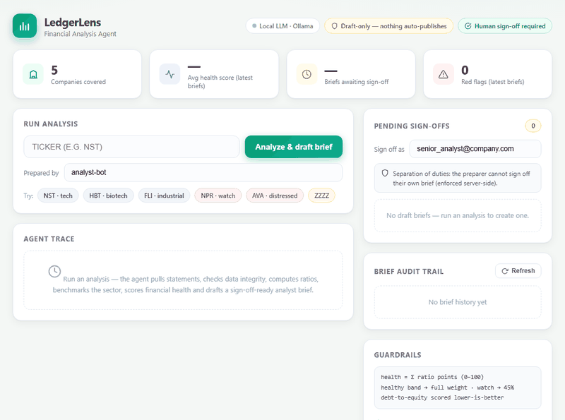
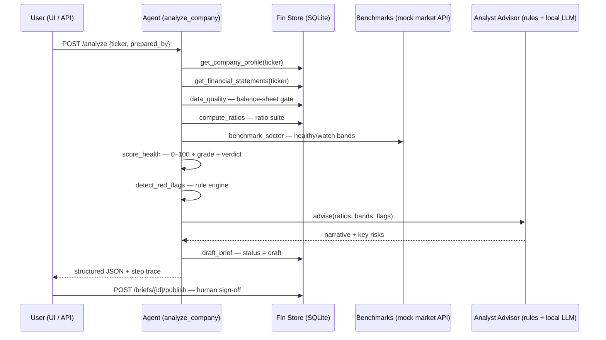
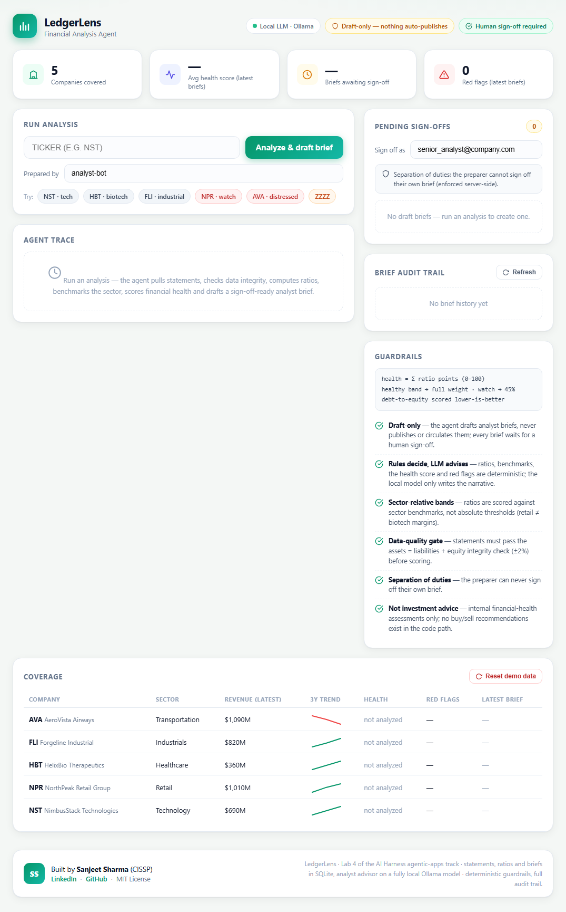
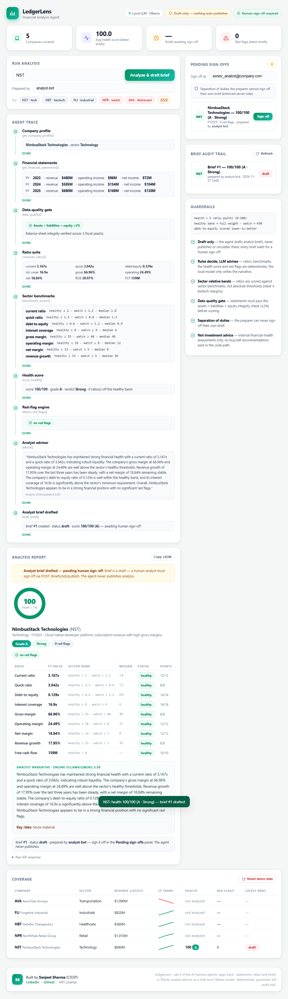
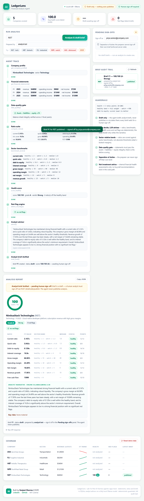

# LedgerLens — Financial Analysis Agent

> **Lab 4 of the AI Harness agentic-apps track.** An agent that answers *"How financially healthy is company X?"* — pulls three fiscal years of financial statements, computes a deterministic ratio suite, benchmarks it against sector bands, scores financial health 0–100, raises rule-based red flags, has a local LLM write the analyst narrative, and drafts an analyst brief that ships only after human sign-off. In business terms: it turns raw statements into a sign-off-ready analyst brief — the math is locked down in code, and the human holds the publish button.

    



**Taxonomy:** Segment `Finance Agents` → Category `Financial Analysis` → Sub-category `Company Financial Analysis`

---

## The problem it solves

Every credit committee and finance team runs some version of the same workflow — pull three years of statements, compute ratios, compare to peers, write a memo, get it signed off. Doing that by hand breaks in four predictable ways:

- **Inconsistent math.** Each analyst computes ratios slightly differently — different definitions, different rounding, TTM vs. fiscal year — so two teams can grade the same company differently, and nobody can prove which numbers fed a verdict.
- **LLM hallucination risk.** Ask a chatbot *"how financially healthy is company X?"* and you get confident prose with plausible-but-fabricated numbers. Finance cannot act on numbers that aren't provably reproducible.
- **No audit trail.** A spreadsheet verdict can't show which rule fired, which sector band a ratio was scored against, or who signed off — fatal when a regulator, auditor, or counterparty asks "how did you reach this?"
- **Lost sector context.** Absolute thresholds mis-grade everyone: a 25% gross margin is excellent for a retailer and alarming for a biotech. Context-free scoring quietly turns sector differences into false alarms — or missed distress.

LedgerLens replaces that workflow with an agent where **the math is locked down in code and the LLM is only the narrator**: every ratio, band, score, and flag is deterministic and reproducible, every brief carries its full step trace and sign-off history, and nothing reaches stakeholders without human sign-off.

---

## What value it provides

| Value | How |
|---|---|
| **Fully local & private** | The analyst advisor runs on a local Ollama model; statements, benchmarks and briefs live in a local SQLite store. Zero data leaves the box, zero API cost. |
| **Deterministic engine, LLM narrator** | Ratios, sector benchmarks, the health score and every red flag are computed in code. The model only writes the narrative prose — the analysis stays correct with or without a model running. |
| **Sector-relative scoring** | Ratios are scored against per-sector benchmark bands (healthy / watch), not absolute thresholds — retail margins aren't graded like biotech margins. |
| **Explainable by default** | Every analysis returns a 9-step trace — statements, data-quality gate, ratio grid, sector bands, per-ratio points, flags, narrative, brief. |
| **Human-in-the-loop by design** | The agent drafts briefs in `draft` status; a human analyst signs off, and the preparer can never sign off their own brief. There is no auto-publish code path. |
| **Clean JSON for apps & dashboards** | One `POST /analyze` returns a structured payload — score, grade, verdict, per-ratio contributions, benchmarks, flags, narrative, brief — plus the trace, ready for any BI tool. |
| **Not investment advice, by construction** | There is no buy/sell recommendation code path; outputs are internal financial-health assessments with full audit trail. |

---

## How it works

The agent orchestrates nine tools over an SQLite finance store (companies, statements, briefs) and a mock market-data provider. The ratio math and scoring are deterministic; the local LLM is a *narrator*, not an analyst:

```python
current_ratio     = current_assets / current_liabilities     # liquidity
interest_coverage = operating_income / interest              # debt service
health_score      = sum(ratio_points)                        # healthy band → full weight,
                                                             # watch band → 45%, off-band → 0
```

### Tools

| Tool | Returns |
|---|---|
| `get_company_profile` | Name, sector, business description |
| `get_financial_statements` | Three fiscal years of income-statement, balance-sheet and cash-flow line items |
| `data_quality` | Balance-sheet integrity gate: assets = liabilities + equity within ±2%, per year |
| `compute_ratios` | Ratio suite per year: current, quick, debt-to-equity, interest coverage, gross/operating/net margins, ROE, ROA, FCF, growth |
| `benchmark_sector` | Per-sector bands (healthy / watch / median) for each scored ratio |
| `score_health` | 0–100 health score, grade A–F, verdict (Strong / Healthy / Watch / Distressed) with per-ratio points |
| `detect_red_flags` | Deterministic flags: liquidity strain, debt-service risk, cash burn, persistent cash burn, margin erosion, top-line contraction, high leverage, earnings quality |
| `advise` | Analyst narrative + key risks (rules decide; `qwen2.5:3b` writes; rules-built fallback without a model) |
| `draft_brief` | Analyst brief in `draft` status with preparer + timestamp for audit |

### Sequence



```mermaid
flowchart LR
    A[POST /analyze] --> B{Ticker found?}
    B -- no --> E[Explain and stop]
    B -- yes --> C[Data-quality gate<br/>assets = liabilities + equity ±2%]
    C --> D[Ratios + sector benchmarks]
    D --> F[Health score 0–100<br/>grade + verdict]
    F --> G[Red-flag engine]
    G --> H[LLM narrative<br/>rules decide, LLM advises]
    H --> I[Draft brief]
    I --> J[Human sign-off<br/>POST /briefs/{id}/publish]
```

---

## Interface

### Web dashboard (`http://127.0.0.1:8083`)

- **KPI strip** — companies covered, average health score, briefs awaiting sign-off, red flags across latest briefs
- **Run analysis** — ticker + preparer with one-click presets (incl. `AVA` to demo the red-flag engine on a distressed carrier and `ZZZZ` for the graceful not-found path)
- **Agent trace** — live timeline: per-year statements, data-quality chip, ratio grid, sector bands, score, flag chips, LLM narrative
- **Analysis report** — health gauge, grade/verdict pills, ratio table with sector bands and points earned, red-flag chips, analyst narrative + key risks, raw JSON with copy button
- **Pending sign-offs** — sign-off identity input, separation-of-duties note, one-click human sign-off
- **Brief audit trail** — every brief with status, preparer, reviewer and timestamps
- **Coverage table** — revenue with 3-year trend sparklines, health scores, red flags, brief status, plus *Reset demo data*







### REST API

| Method | Path | Purpose |
|---|---|---|
| `GET` | `/companies` | Company roster: latest revenue, 3-year trend, last brief |
| `GET` | `/companies/{ticker}` | One company: profile + statements + ratio suite |
| `POST` | `/analyze` | Full flow: statements → data quality → ratios → benchmarks → score → flags → narrative → draft brief. Body: `{"ticker": "NST", "prepared_by": "analyst-bot"}` |
| `GET` | `/briefs/open` | Draft briefs awaiting sign-off |
| `GET` | `/briefs/recent` | Latest briefs (audit trail) |
| `POST` | `/briefs/{brief_id}/publish` | Human sign-off. Body: `{"reviewer": "senior_analyst@company.com"}`. Preparer ≠ reviewer enforced |
| `POST` | `/admin/reset` | Reseed demo data (companies, statements; clears brief history) |
| `GET` | `/` | The dashboard |

```bash
# Analyze a company (auto-runs the full flow and drafts a brief)
curl -X POST http://127.0.0.1:8083/analyze \
     -H 'Content-Type: application/json' \
     -d '{"ticker":"AVA","prepared_by":"analyst-bot"}'

# See draft briefs, then sign one off
curl -s http://127.0.0.1:8083/briefs/open | jq
curl -X POST http://127.0.0.1:8083/briefs/2/publish \
     -H 'Content-Type: application/json' -d '{"reviewer":"senior_analyst@company.com"}'
```

The analyze response is a single structured JSON: `score`, `grade`, `verdict`, `contributions[]` (per-ratio value, band, points), `benchmarks`, `red_flags[]`, `narrative`, `key_risks`, `brief` (id, status, preparer), `review` (sign-off status) and `steps[]` — the full trace.

---

## Usage

**Prerequisites:** Python 3.11+. Optional: [Ollama](https://ollama.com) running locally with a small model pulled — without it the advisor falls back to a rule-built narrative and everything still works:

```bash
ollama pull qwen2.5:3b
```

**Install & run** (Windows; on macOS/Linux use `.venv/bin/`):

```bash
cd "Finance Agents/financial-analysis/financial-analysis-agent"
python -m venv .venv
.venv\Scripts\python -m pip install -r requirements.txt
.venv\Scripts\python -m uvicorn main:app --port 8083
```

Open **http://127.0.0.1:8083**, pick the `NST` preset (a clean A-grade tech company), then try `AVA` — the distressed carrier that trips all seven red-flag rules — and sign a brief off in the **Pending sign-offs** panel (use a reviewer name different from the preparer to see the separation-of-duties gate in action).

**Configuration** (`.env`, gitignored):

| Var | Default | Role |
|---|---|---|
| `OLLAMA_BASE_URL` | `http://localhost:11434` | Ollama endpoint |
| `OLLAMA_MODEL` | `qwen2.5:3b` | Analyst advisor (narrative + key risks) |

The database (`fin.db`) is created and seeded automatically on first start; existing data — including brief history — survives restarts. Use **Reset demo data** (or `POST /admin/reset`) for a clean slate.

**Performance reference** (RTX 5050 laptop GPU, 8 GB): ~4 s per analysis with the model resident, ~15 s on the first run (model load); rules-only mode is effectively instant.

---

## Security & guardrails

- **Draft-only** — there is no auto-publish code path; the system can only create briefs in `draft` status and record human sign-offs.
- **Deterministic engine decides** — ratios, benchmarks, the 0–100 score, grade and every red flag are computed in code; the LLM only writes narrative prose and can never change the verdict.
- **Data-quality gate** — statements must pass the assets = liabilities + equity integrity check (±2%) before any scoring runs.
- **Sector-relative bands** — scoring uses per-sector benchmark tables, so a 25% gross margin isn't penalized for a retailer and ignored for a biotech.
- **Separation of duties** — `/briefs/{id}/publish` rejects when the reviewer equals the preparer (case-insensitive), enforced server-side.
- **Auditable** — every brief stores `prepared_by`, `reviewed_by`, `created_at`, `published_at`; the UI exposes the full audit trail; every analysis returns its tool trace.
- **Input sanitization** — ticker and identity fields are stripped to a safe charset and length-capped before they reach SQL or the LLM prompt.
- **No hardcoded secrets** — config lives in a gitignored `.env`; the finance store holds synthetic demo data only.
- **Known limits (by design, it's a lab)** — statements are synthetic and static; benchmark bands are hard-coded sector estimates; the API and reset endpoint have no auth; scoring uses the latest fiscal year (trends are shown but only margin erosion looks at history); briefs don't auto-revise when new data arrives.

---

## From lab to production — the autonomy ladder

| Level | Milestone | What it takes |
|---|---|---|
| **L0 — this lab** | Manual trigger, synthetic statements, hard-coded sector bands, single-step human sign-off | ✅ done |
| **L1 — real integrations** | Real fundamentals (SEC EDGAR/XBRL, Alpha Vantage, Capital IQ), Postgres, multi-currency statements, live benchmark feeds | Provider credentials, data contracts, financial-data QA |
| **L2 — human-in-the-loop at scale** | Review queue with roles + risk thresholds (e.g. distressed names need a senior reviewer), edit-before-publish, immutable audit trail, API auth + RBAC | Identity provider, draft-state machine, review UI |
| **L3 — scheduled autonomy** | Nightly re-screen of the whole coverage universe, score-delta and new-flag alerts, watchlists, streaming trace (SSE), observability, eval harness scored against analyst-written memos | Job scheduler, telemetry stack, golden-set evals |
| **L4 — production credit platform** | Portfolio monitoring, covenant tracking, RAG grounding on filings and 10-Ks, peer-group discovery, regulator-friendly audit exports, model risk management | Compliance sign-off, retrieval pipeline, containers + CI/CD, secrets manager |

The tool set, data-quality gate, trace format and brief-state model built here carry forward unchanged — production work is swapping the synthetic store for real fundamentals feeds and wrapping the flow in the L1–L4 operational layers.

**This repo already ships the L4 container layer.** A production-grade deployment — Docker image (non-root, healthchecked), PostgreSQL, containerized Ollama, TLS termination via nginx, hardened config — is included and validated end-to-end. See [DEPLOYMENT.md](DEPLOYMENT.md) for the lab→production delta, quick start, backups, security checklist and go-live list.

---

## Project layout

```
financial-analysis-agent/
├── fin_db.py          # SQLite engine, schema, seed-once + reset
├── fin.py             # ratio suite, health score, red-flag engine, brief CRUD + separation of duties
├── market_api.py      # sector benchmark bands + balance-sheet data-quality gate (mock provider)
├── analyst_llm.py     # deterministic narrative fallback + Ollama analyst advisor
├── agent.py           # analyze_company orchestration returning a step trace
├── main.py            # FastAPI service (dashboard + clean JSON API)
├── static/index.html  # dashboard (self-contained, no build step)
├── requirements.txt   # fastapi · uvicorn · sqlalchemy · requests · python-dotenv
├── deploy/            # production assets: Dockerfile, docker-compose (app+Postgres+Ollama+nginx TLS), .env example
├── DEPLOYMENT.md      # production-grade deployment guide (validated end-to-end with Docker)
├── .env               # local config (gitignored)
└── docs/assets/       # screenshots + demo.gif
```

---

*Built as **Lab 4: Financial Analysis Agent** in the AI Harness track — the classic statements → ratios → benchmarks → credit-memo workflow, with deterministic guardrails, a local Ollama analyst, and a human sign-off gate.*

*Authored by **Sanjeet Sharma** (CISSP) · [LinkedIn](https://www.linkedin.com/in/sanjeet-sharma-cissp-17b68570/) · [GitHub](https://github.com/SharmaSanjeet) · [MIT License](../../../LICENSE)*
